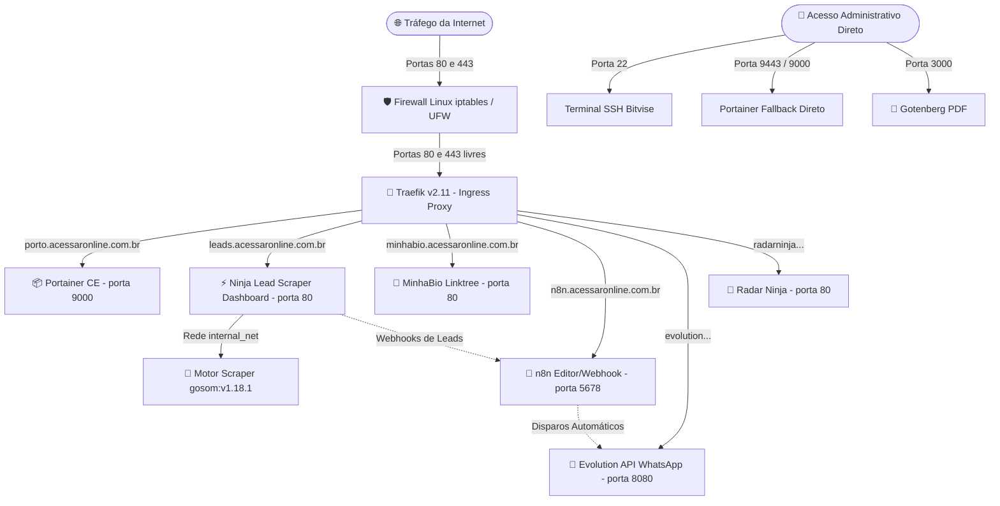

# 🛡️ GUIA DEFINITIVO DA ARQUITETURA DA VPS — AGÊNCIA NINJA
> **DOCUMENTO OFICIAL DE INFRAESTRUTURA, SEGURANÇA E REGRAS DE OURO**  
> *Versão: 2.0 (Atualizada após resolução dos incidentes de Firewall, Conflito de Porta e MinhaBio)*  
> *Ambiente: VPS Hostinger Ubuntu 24.04 LTS — IP Fixo: `103.199.184.118`*  
> *Gerenciador: Docker Swarm (Cluster Ativo) + Proxy Reverso Traefik v2.11*

---

## ⚠️ AS 5 REGRAS DE OURO DA VPS (LEITURA OBRIGATÓRIA ANTES DE QUALQUER AÇÃO)

> [!CAUTION]
> ### 1. NUNCA INSTALAR OU INICIAR O NGINX OU APACHE NATIVO NO UBUNTU (`systemd`)!
> - **O que aconteceu:** Em 17/10/2026, um serviço `nginx` nativo do Ubuntu foi iniciado na porta 80. Isso sequestrou a porta 80 do Traefik.
> - **O sintoma:** O Traefik apresentou o erro `accept tcp [::]:80: use of closed network connection`, fechou a porta HTTPS 443 e não conseguiu validar certificados na Let's Encrypt (`Timeout during connect (likely firewall problem)`). **TODOS os sites da VPS caíram.**
> - **A Regra:** Se qualquer dashboard ou aplicação precisar de Nginx, ele DEVE RODAR DENTRO DE UM CONTAINER DOCKER, NUNCA no sistema operacional nativo da VPS.
> - **Comando preventivo/corretivo:**  
>   ```bash
>   systemctl stop nginx && systemctl disable nginx
>   ```

> [!WARNING]
> ### 2. O FIREWALL É INTERNO NO LINUX (IPTABLES) — O PAINEL DA HOSTINGER FICA VAZIO
> - A VPS foi vítima de invasão no passado, momento em que foi configurada uma política rígida de firewall diretamente no `iptables` do Ubuntu.
> - No painel web da Hostinger não há regras visíveis porque a proteção está ativa **dentro do kernel Linux**.
> - As portas **`80` (HTTP)**, **`443` (HTTPS)**, **`22` (SSH)** e **`9443` (Portainer Direto)** DEVEM estar **sempre no topo da cadeia `INPUT` e `DOCKER-USER`** do `iptables`.

> [!IMPORTANT]
> ### 3. A REDE SWARM GLOBAL DO TRAEFIK É `ninja_net` (NÃO USE `traefik-public`)
> - A rede overlay compartilhada por onde o Traefik conversa com todos os containers da VPS chama-se **`ninja_net`**.
> - Em qualquer novo `docker-stack.yml`, utilize:
>   ```yaml
>   networks:
>     ninja_net:
>       external: true
>   ```

> [!IMPORTANT]
> ### 4. O NOME DO CERTRESOLVER SSL NO TRAEFIK É `letsencryptresolver`
> - O certificado SSL automático da Let's Encrypt gerado pelo Traefik está registrado sob o nome **`letsencryptresolver`**.
> - Configuração padrão nas labels:
>   ```yaml
>   - "traefik.http.routers.<nome>.tls.certresolver=letsencryptresolver"
>   ```

> [!NOTE]
> ### 5. O ERRO `404 page not found` É RESPOSTA DO TRAEFIK (SERVIÇO EM `0/1` OU MORTO)
> - Se o navegador exibir uma tela branca simples com `404 page not found`, **o DNS, o Firewall e o SSL estão 100% funcionando!**
> - O significado real: O Traefik recebeu o domínio, mas o container de destino está com `0/1` réplicas, `Shutdown` ou `Dead` (exatamente o que ocorreu com o `minhabio_app`).
> - **Solução imediata:** `docker service update --force <nome_do_serviço>`

---

## 🗺️ MAPA GERAL DA INFRAESTRUTURA



---

## 📋 CATÁLOGO COMPLETO DE SERVIÇOS ATIVOS NA VPS

Mapeamento real obtido via `docker service ls` no Docker Swarm:

| Nome do Serviço no Swarm | Imagem Docker | Subdomínio / Função | Rede Swarm | Portas Publicadas |
| :--- | :--- | :--- | :--- | :--- |
| **`traefik_traefik`** | `traefik:v2.11` | Proxy Reverso Principal & SSL | `ninja_net` | `*:80->80`, `*:443->443` |
| **`portainer_portainer`** | `portainer/portainer-ce:2.21.5` | `porto.acessaronline.com.br` | `ninja_net` | `*:8000`, `*:9000`, `*:9443` |
| **`portainer_agent`** | `portainer/agent:2.21.5` | Agente de Monitoramento Swarm | `host` | Modo Global |
| **`ninja-scraper_dashboard`**| `nginx:1.27-alpine` | `leads.acessaronline.com.br` | `ninja_net`, `internal_net` | Via Traefik (80) |
| **`ninja-scraper_scraper`**  | `gosom/google-maps-scraper` | Motor de Extração Go | `internal_net` | Interna (8080) |
| **`minhabio_app`** | `nginx:alpine` | `minhabio.acessaronline.com.br` | `ninja_net` | Via Traefik (80) |
| **`n8n_n8n_editor`** | `n8nio/n8n:latest` | `n8n.acessaronline.com.br` | `ninja_net` | Via Traefik (5678) |
| **`n8n_n8n_runner`** | `n8nio/runners:latest` | Executor de Fila do n8n | `ninja_net` | Interna |
| **`n8n_n8n_webhook`** | `n8nio/n8n:latest` | Receptor de Webhooks n8n | `ninja_net` | Via Traefik (5678) |
| **`n8n_n8n_worker`** | `n8nio/n8n:latest` | Processamento Assíncrono | `ninja_net` | Interna |
| **`evolution_evolution`** | `evoapicloud/evolution-api:v2.3.3` | API Oficial de WhatsApp | `ninja_net` | Via Traefik (8080) |
| **`radarninja_radarninja`** | `ghcr.io/salesioninja/radarninja` | Painel Radar Ninja | `ninja_net` | Via Traefik |
| **`clonagem_backend`** | `ghcr.io/salesioninja/clonagem-ninja` | Backend Clonagem Ninja | `ninja_net` | Via Traefik |
| **`gotenberg_gotenberg`** | `gotenberg/gotenberg:8` | Conversor de Documentos/PDF | `ninja_net` | `*:3000->3000` |
| **`postgres_postgres`** | `postgres:14` | Banco de Dados Relacional | `ninja_net` | Interna (5432) |
| **`redis_redis`** | `redis:latest` | Fila e Cache em Memória | `ninja_net` | Interna (6379) |
| **`nfc-review_app`** | `nfc-review-master:latest` | Aplicação de Avaliações NFC | `ninja_net` | Via Traefik |
| **`hermes_hermes`** | `nousresearch/hermes-agent` | Agente de IA Hermes | `ninja_net` | Interna |
| **`hermes_downloads`** | `nginx:alpine` | Servidor de Arquivos Hermes | `ninja_net` | Interna |

---

## 🔒 POLÍTICA DE FIREWALL DA VPS (IPTABLES E UFW)

Se a VPS for reiniciada ou houver qualquer dúvida sobre o tráfego bloqueado, basta colar este bloco no Bitvise como `root`:

```bash
# 1. Desativar qualquer Nginx nativo acidental
systemctl stop nginx 2>/dev/null || true
systemctl disable nginx 2>/dev/null || true

# 2. Inserir regras ACCEPT prioritárias no iptables (Linha 1 do INPUT)
iptables -I INPUT 1 -p tcp --dport 80 -j ACCEPT
iptables -I INPUT 1 -p tcp --dport 443 -j ACCEPT
iptables -I INPUT 1 -p tcp --dport 22 -j ACCEPT
iptables -I INPUT 1 -p tcp --dport 9443 -j ACCEPT
iptables -I INPUT 1 -p tcp --dport 9000 -j ACCEPT

# 3. Garantir roteamento para containers Docker
iptables -I DOCKER-USER 1 -p tcp --dport 80 -j ACCEPT 2>/dev/null || true
iptables -I DOCKER-USER 1 -p tcp --dport 443 -j ACCEPT 2>/dev/null || true

# 4. Caso o UFW esteja instalado
ufw allow 22/tcp comment 'SSH'
ufw allow 80/tcp comment 'Traefik HTTP'
ufw allow 443/tcp comment 'Traefik HTTPS'
ufw allow 9443/tcp comment 'Portainer 9443'
ufw allow 9000/tcp comment 'Portainer 9000'
ufw default allow routed
```

---

## 🚀 MODELO PADRÃO PARA SUBIR QUALQUER NOVO PROJETO (SWARM STACK)

Ao criar um novo arquivo `docker-stack.yml`, utilize sempre esta estrutura base que garante compatibilidade total com o Traefik da Agência Ninja:

```yaml
version: '3.8'

services:
  app:
    image: sua-imagem:tag
    networks:
      - ninja_net
    deploy:
      replicas: 1
      restart_policy:
        condition: on-failure
        delay: 5s
        max_attempts: 3
      labels:
        - "traefik.enable=true"
        - "traefik.docker.network=ninja_net"
        
        # Rota HTTPS Principal
        - "traefik.http.routers.meuapp.rule=Host(`meuapp.acessaronline.com.br`)"
        - "traefik.http.routers.meuapp.entrypoints=websecure"
        - "traefik.http.routers.meuapp.tls=true"
        - "traefik.http.routers.meuapp.tls.certresolver=letsencryptresolver"
        
        # Porta interna do container (ex: 80, 3000, 5678, 8080)
        - "traefik.http.services.meuapp.loadbalancer.server.port=80"
        
        # Redirecionamento HTTP -> HTTPS
        - "traefik.http.routers.meuapp-http.rule=Host(`meuapp.acessaronline.com.br`)"
        - "traefik.http.routers.meuapp-http.entrypoints=web"
        - "traefik.http.routers.meuapp-http.middlewares=meuapp-redirect"
        - "traefik.http.middlewares.meuapp-redirect.redirectscheme.scheme=https"
        - "traefik.http.middlewares.meuapp-redirect.redirectscheme.permanent=true"

networks:
  ninja_net:
    external: true
```

---

## 🛠️ GUIA DE DIAGNÓSTICO RÁPIDO (GUIA DE 60 SEGUNDOS)

| Sintoma | Causa Mais Provável | Comando para Resolver |
| :--- | :--- | :--- |
| **Todos os sites dando Timeout** | Nginx nativo do Ubuntu sequestrou a porta 80 | `systemctl stop nginx && systemctl disable nginx`<br>`docker service update --force traefik_traefik` |
| **Site dando `404 page not found`** | Container do site está com `0/1` réplicas ou `Dead` | `docker service update --force <nome_do_serviço>` |
| **Erro de certificado SSL Let's Encrypt** | Porta 80 bloqueada ou certresolver com nome errado | Conferir `letsencryptresolver` e verificar `ss -tlpn \| grep :80` |
| **Portainer fora pelo domínio mas abre por IP** | Traefik precisa de recarga das portas | `docker service update --force traefik_traefik` |
| **Serviço específico não sobe** | Pasta ou volume bind não existe no disco da VPS | `docker service ps --no-trunc <nome_do_serviço>` para ler o erro exato |

---
*Documento homologado e registrado no repositório da Agência Ninja.*
